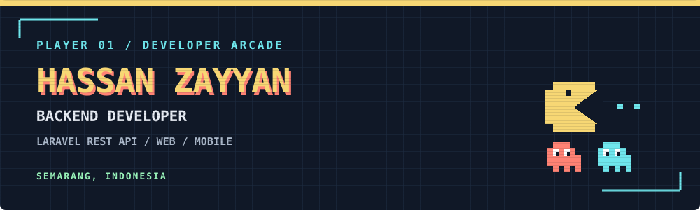
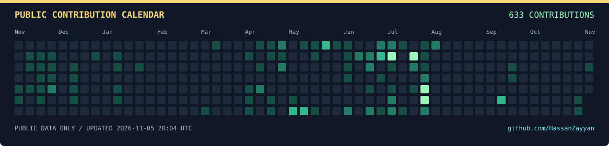
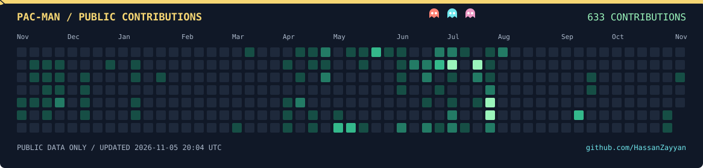

<p align="center">
  
</p>

<p align="center">
  <a href="https://hassanzayyan.my.id"></a>
  <a href="https://www.linkedin.com/in/muhammad-hassan-naufal-zayyan-79a692283/"></a>
  <a href="mailto:mhnzayyan@gmail.com"></a>
</p>

## 👾 Player profile

Hi, I'm **Hassan**, a D3 Informatics graduate from **Politeknik Negeri Semarang**, based in Semarang, Indonesia. I focus on **backend development**, with experience from an internship at Diskominfo Kabupaten Semarang and freelance projects for village governments.

I build Laravel REST APIs, design relational databases, migrate spreadsheet data, and develop reporting, access control and audit trails. I also contribute to **Next.js/PWA and Flutter** applications and deploy applications with **Docker, Nginx and GitHub Actions on Ubuntu VPS**.

```text
PLAYER     Hassan Zayyan
MAIN ROLE  Backend Developer
MISSIONS   Useful APIs · Reliable data · Applications people can use
NEXT LEVEL Internal business applications & ERP integration
```

## 🧰 Equipment inventory

**Backend & databases**


**Web & mobile contributions**


**Deployment & tools**


## 🗂️ Mission archive

### 01 / SIPANDAI Rembes · Freelance

**Attendance and performance reporting for 13 village officials.** Built Laravel REST APIs with PostgreSQL for attendance, leave approvals, role-based access and monthly PDF/Excel reports. Implemented geofencing, duplicate-attendance prevention, report locking and audit trails; contributed to API integration and session/cache fixes in the Next.js PWA.

`Laravel` `PostgreSQL` `Next.js / PWA` `Docker` `GitHub Actions`

**[Explore the case study →](https://hassanzayyan.my.id/work/sipandai-rembes)**

### 02 / AGEN — Absensi Gedangan · Freelance

**A Flutter attendance application for 13 staff.** Built Laravel REST APIs and MySQL storage for face enrollment and verification using an existing MobileFaceNet model. Contributed to Flutter history filters, session handling and face-processing components, and fixed an attendance-scoring time-boundary bug.

`Laravel` `MySQL` `Flutter / Dart` `Docker` `Ubuntu VPS`

**[Explore the case study →](https://hassanzayyan.my.id/work/absensi-gedangan)**

### 03 / TowerTrack · Internship at Diskominfo Kabupaten Semarang

**A public map of telecommunications towers and fiber-optic routes.** Modeled and migrated spreadsheet records into MySQL, built map filters and public reporting/correction endpoints, and packaged the Laravel + Inertia.js application with Docker.

`Laravel` `Inertia.js` `MySQL` `Docker`

**[Explore the case study →](https://hassanzayyan.my.id/work/towertrack)** · [Public demo repository](https://github.com/HassanZayyan/TowerTrack-Diskominfo-Dummy-)

### 04 / Bang Deliv · D3 final project · Two-person team

**A ride-hailing, delivery and errand-service application.** Built Laravel REST APIs and MySQL for orders, driver assignment, tracking, chat and **static QRIS payments**. Integrated Gemini API into the chatbot to turn natural-language conversations into structured order JSON; contributed to Flutter merchant selection, cancellations and session/order state with Riverpod.

`Laravel` `MySQL` `Gemini API` `Flutter` `Riverpod`

**[Explore the case study →](https://hassanzayyan.my.id/projects/bang-deliv)** · [Backend](https://github.com/HassanZayyan/backend_bangdeliv) · [Mobile app](https://github.com/HassanZayyan/frontend_bangdeliv)

## 🟡 Contribution arcade

**One public calendar, two views.** Both images below are generated from the same public GitHub contribution data. They refresh every six hours; the last successful update and public contribution total are printed on each image.



<details open>
<summary><b>Press start — Pac-Man animation</b></summary>
<br />
<picture>
<source media="(prefers-reduced-motion: reduce)" srcset="https://raw.githubusercontent.com/HassanZayyan/HassanZayyan/output/contribution-calendar.svg" />

</picture>
</details>

> Pac-Man eats the colored cells during each loop. The static calendar above preserves the original grid. Private activity visible only to the account owner is excluded, so the public total may differ from the total shown while signed in.

[Check the original GitHub calendar](https://github.com/HassanZayyan?tab=overview#year-list-container) · [Refresh workflow](https://github.com/HassanZayyan/HassanZayyan/actions/workflows/pacman.yml) · [Public data snapshot](https://github.com/HassanZayyan/HassanZayyan/blob/output/contributions.json)

---

**Want the project details? [Open my portfolio →](https://hassanzayyan.my.id)**
